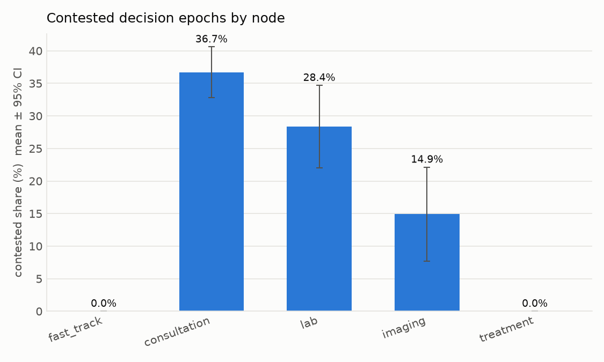
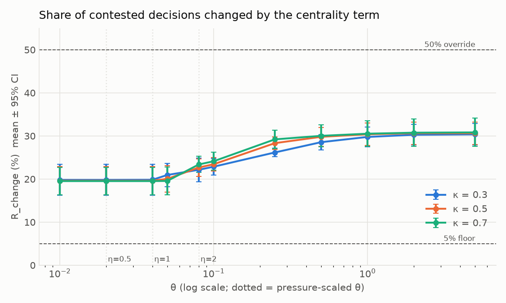
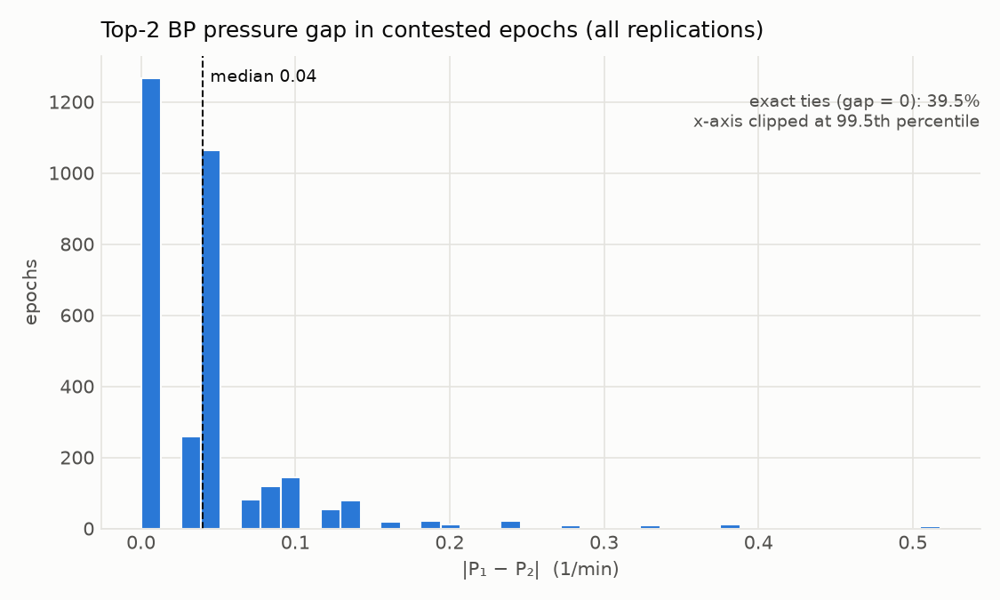

# Decision-impact pilot: Katz-BP vs plain BP (shadow evaluation)

## Verdict

- **ACTIVE RANGE (excluding ties): θ ∈ [0.1, 0.25], κ = 0.3**
- **ACTIVE RANGE (excluding ties): θ ∈ [0.08, 0.1], κ = 0.5**
- **ACTIVE RANGE (excluding ties): θ ∈ [0.08, 0.1], κ = 0.7**
- **TIE-BREAK ONLY κ = 0.3: θ ∈ {0.01, 0.02, 0.04, 0.05, 0.08} (R_change ≥ 5% with ties, < 5% without)**
- **TIE-BREAK ONLY κ = 0.5: θ ∈ {0.01, 0.02, 0.04, 0.05} (R_change ≥ 5% with ties, < 5% without)**
- **TIE-BREAK ONLY κ = 0.7: θ ∈ {0.01, 0.02, 0.04, 0.05} (R_change ≥ 5% with ties, < 5% without)**
- **KATZ ≈ ONE-HOP: full-network signal adds few distinct decisions.**
- **SCENARIO A (baseline): KATZ ≈ ONE-HOP**
- **SCENARIO B (high load): KATZ ≈ ONE-HOP**
- **SCENARIO C (lab shock): KATZ ≈ ONE-HOP**
- **SCENARIO C-window (lab shock, window): KATZ ≈ ONE-HOP**
- **SCENARIO D (blocking): KATZ ≈ ONE-HOP**

The ACTIVE RANGE uses R_change **excluding exact BP ties** (bp_top2_gap > 0) ≥ 5% together with a dominance ratio < 1. TIE-BREAK ONLY marks θ whose R_change reaches 5% only because of tied BP pressures, where the centrality term replaces the head-of-line tie-break.

> Model parameters are PROVISIONAL placeholders. This pilot asks only whether the centrality term changes decisions; it says nothing about congestion.

## Candidate set (κ = 0.5)

| θ | R_change incl. ties | R_change excl. ties | dominance ratio | status |
|---|---|---|---|---|
| 0.02 | 19.6% ± 3.3% | 0.0% ± 0.0% | 0.0987 ± 0.0105 | TIE-BREAK ONLY |
| 0.1 | 23.4% ± 1.5% | 6.3% ± 2.7% | 0.494 ± 0.0526 | ACTIVE |
| 0.25 | 28.3% ± 1.5% | 14.4% ± 3.8% | 1.23 ± 0.132 | BP not dominant (ratio ≥ 1) |

## Set-up

- Replications: 5 (seeds [11001, 22002, 33003, 44004, 55005]); warm-up 24 h discarded; 7 observed days per replication.
- Arrival rate λ = 0.2129 /min (306.6 patients/day), calibrated so the bottleneck (consultation) has ρ = 0.85.
- Served FCFS (no policy, no decision epochs): registration, triage. Policy nodes: fast_track, consultation, lab, imaging, treatment.
- Spectral radius ρ(A) = 0.5862; α = κ/ρ(A): κ=0.3 → α=0.5118, κ=0.5 → α=0.8530, κ=0.7 → α=1.1942.
- Median top-2 BP gap (rep 1, contested, post warm-up) = 0.04 /min; pressure-scaled θ: η=0.5 → θ=0.02, η=1 → θ=0.04, η=2 → θ=0.08.
- Post-warm-up decision epochs: 2275 ± 212.1 per replication.

### Node utilisation (analytic target vs achieved)

| node | servers | analytic | achieved (mean ± 95% CI) |
|---|---|---|---|
| registration | 2 | 0.482 | 0.483 ± 0.0152 |
| triage | 2 | 0.772 | 0.765 ± 0.0273 |
| fast_track | 2 | 0.533 | 0.536 ± 0.0264 |
| consultation | 5 | 0.850 | 0.854 ± 0.0216 |
| lab | 2 | 0.806 | 0.795 ± 0.0778 |
| imaging | 2 | 0.625 | 0.645 ± 0.0449 |
| treatment | 4 | 0.483 | 0.48 ± 0.025 |

## Contested share

Overall: **28.1% ± 2.4%** of decision epochs.

| node | epochs / rep | contested share |
|---|---|---|
| fast_track | 242.4 ± 36.08 | 0.0% ± 0.0% |
| consultation | 1330 ± 142.3 | 36.7% ± 3.9% |
| lab | 382.8 ± 71.34 | 28.4% ± 6.3% |
| imaging | 260.2 ± 45.52 | 14.9% ± 7.2% |
| treatment | 59.4 ± 20.34 | 0.0% ± 0.0% |

## R_change(κ, θ) including ties — changed ÷ contested epochs (overall)

| κ \ θ | 0.01 | 0.02 | η=0.5 (0.02) | η=1 (0.04) | 0.05 | η=2 (0.08) | 0.1 | 0.25 | 0.5 | 1 | 2 | 5 |
|---|---|---|---|---|---|---|---|---|---|---|---|---|
| 0.3 | 19.8% ± 3.6% | 19.8% ± 3.6% | 19.8% ± 3.6% | 19.8% ± 3.6% | 20.9% ± 2.7% | 22.1% ± 2.7% | 22.9% ± 1.9% | 26.2% ± 1.0% | 28.6% ± 1.8% | 29.8% ± 2.3% | 30.3% ± 2.4% | 30.4% ± 2.5% |
| 0.5 | 19.6% ± 3.3% | 19.6% ± 3.3% | 19.6% ± 3.3% | 19.6% ± 3.3% | 20.0% ± 3.1% | 22.7% ± 2.0% | 23.4% ± 1.5% | 28.3% ± 1.5% | 29.8% ± 2.2% | 30.4% ± 2.6% | 30.6% ± 2.6% | 30.6% ± 2.6% |
| 0.7 | 19.5% ± 3.2% | 19.5% ± 3.2% | 19.5% ± 3.2% | 19.5% ± 3.2% | 19.6% ± 3.2% | 23.4% ± 1.9% | 24.1% ± 2.1% | 29.2% ± 2.1% | 30.0% ± 2.5% | 30.5% ± 3.0% | 30.8% ± 3.2% | 30.8% ± 3.3% |

## R_change(κ, θ) excluding exact BP ties — verdict basis

Changed ÷ contested epochs whose top-2 BP gap is > 0, i.e. decisions where the centrality term overrides a real pressure difference rather than breaking a tie.

| κ \ θ | 0.01 | 0.02 | η=0.5 (0.02) | η=1 (0.04) | 0.05 | η=2 (0.08) | 0.1 | 0.25 | 0.5 | 1 | 2 | 5 |
|---|---|---|---|---|---|---|---|---|---|---|---|---|
| 0.3 | 0.0% ± 0.0% | 0.0% ± 0.0% | 0.0% ± 0.0% | 0.1% ± 0.1% | 1.8% ± 1.8% | 3.9% ± 1.3% | 5.0% ± 2.6% | 10.4% ± 4.8% | 14.4% ± 4.0% | 16.4% ± 4.9% | 17.2% ± 4.7% | 17.4% ± 4.8% |
| 0.5 | 0.0% ± 0.0% | 0.0% ± 0.0% | 0.0% ± 0.0% | 0.0% ± 0.0% | 0.7% ± 0.8% | 5.0% ± 1.9% | 6.3% ± 2.7% | 14.4% ± 3.8% | 16.8% ± 4.7% | 17.8% ± 5.0% | 18.2% ± 4.8% | 18.2% ± 4.8% |
| 0.7 | 0.0% ± 0.0% | 0.0% ± 0.0% | 0.0% ± 0.0% | 0.0% ± 0.0% | 0.1% ± 0.1% | 6.3% ± 2.0% | 7.6% ± 1.6% | 15.9% ± 4.3% | 17.3% ± 4.6% | 18.2% ± 5.0% | 18.6% ± 5.2% | 18.7% ± 5.4% |

### R_change including ties, by node (κ = 0.5)

| node | 0.01 | 0.02 | η=0.5 (0.02) | η=1 (0.04) | 0.05 | η=2 (0.08) | 0.1 | 0.25 | 0.5 | 1 | 2 | 5 |
|---|---|---|---|---|---|---|---|---|---|---|---|---|
| fast_track | n/a | n/a | n/a | n/a | n/a | n/a | n/a | n/a | n/a | n/a | n/a | n/a |
| consultation | 19.7% ± 4.2% | 19.7% ± 4.2% | 19.7% ± 4.2% | 19.7% ± 4.2% | 19.7% ± 4.2% | 19.7% ± 4.2% | 19.9% ± 4.1% | 22.5% ± 3.5% | 23.8% ± 3.5% | 24.4% ± 3.8% | 24.7% ± 3.8% | 24.7% ± 3.8% |
| lab | 16.4% ± 5.5% | 16.4% ± 5.5% | 16.4% ± 5.5% | 16.4% ± 5.5% | 18.7% ± 4.1% | 28.7% ± 4.0% | 31.9% ± 5.6% | 46.7% ± 3.7% | 49.0% ± 3.4% | 49.5% ± 3.1% | 49.8% ± 2.9% | 49.8% ± 2.9% |
| imaging | 29.6% ± 11.4% | 29.6% ± 11.4% | 29.6% ± 11.4% | 29.6% ± 11.4% | 30.2% ± 11.5% | 43.2% ± 11.2% | 44.0% ± 10.2% | 47.9% ± 7.2% | 49.1% ± 6.9% | 49.1% ± 6.9% | 49.1% ± 6.9% | 49.1% ± 6.9% |
| treatment | n/a | n/a | n/a | n/a | n/a | n/a | n/a | n/a | n/a | n/a | n/a | n/a |

All κ and nodes are in `pilot_summary.csv` (metric `r_change`). `n/a` means the node had no contested epochs.

## Pressure and centrality gaps (contested epochs)

| quantity | median | IQR |
|---|---|---|
| bp_top2_gap (1/min) | 0.0387 ± 0.0037 | 0.0471 ± 0 |
| cent_gap_top2, κ=0.3 | 0.171 ± 0.0595 | 0.336 ± 0.119 |
| cent_gap_top2, κ=0.5 | 0.26 ± 0.07 | 0.297 ± 0.0802 |
| cent_gap_top2, κ=0.7 | 0.334 ± 0.058 | 0.313 ± 0.0443 |

### Exact BP ties among contested epochs, by node

At a tie (gap = 0) any θ > 0 with a non-zero centrality gap decides the outcome instead of the head-of-line tie-break.

| node | contested epochs / rep | exact-tie share |
|---|---|---|
| fast_track | 0 ± 0 | n/a |
| consultation | 490.4 ± 96.12 | 40.1% ± 6.5% |
| lab | 110.6 ± 44.19 | 34.0% ± 2.9% |
| imaging | 39.8 ± 21.96 | 51.5% ± 14.2% |
| treatment | 0 ± 0 | n/a |
| ALL | 640.8 ± 104.1 | 39.8% ± 4.8% |

## Dominance ratio — median of θ·cent_gap_top2 ÷ bp_top2_gap

Below 1 means BP pressure still dominates the typical contested decision (ties with gap = 0 excluded).

| κ \ θ | 0.01 | 0.02 | η=0.5 (0.02) | η=1 (0.04) | 0.05 | η=2 (0.08) | 0.1 | 0.25 | 0.5 | 1 | 2 | 5 |
|---|---|---|---|---|---|---|---|---|---|---|---|---|
| 0.3 | 0.0373 ± 0.00835 | 0.0746 ± 0.0167 | 0.0746 ± 0.0167 | 0.149 ± 0.0334 | 0.186 ± 0.0418 | 0.298 ± 0.0668 | 0.373 ± 0.0835 | 0.932 ± 0.209 | 1.86 ± 0.418 | 3.73 ± 0.835 | 7.46 ± 1.67 | 18.6 ± 4.18 |
| 0.5 | 0.0494 ± 0.00526 | 0.0987 ± 0.0105 | 0.0987 ± 0.0105 | 0.197 ± 0.021 | 0.247 ± 0.0263 | 0.395 ± 0.0421 | 0.494 ± 0.0526 | 1.23 ± 0.132 | 2.47 ± 0.263 | 4.94 ± 0.526 | 9.87 ± 1.05 | 24.7 ± 2.63 |
| 0.7 | 0.0663 ± 0.00392 | 0.133 ± 0.00783 | 0.133 ± 0.00783 | 0.265 ± 0.0157 | 0.332 ± 0.0196 | 0.531 ± 0.0313 | 0.663 ± 0.0392 | 1.66 ± 0.0979 | 3.32 ± 0.196 | 6.63 ± 0.392 | 13.3 ± 0.783 | 33.2 ± 1.96 |

## Katz vs one-hop

1H-BP uses h = q + α Aᵀq, the first two terms of the Katz series, with the same α = κ/ρ(A) (κ = 0.5): ĥ = h / (1 + max|h|) and W_c = μ_i^c (Q_i^c − Q_j^c) + θ_h (ĥ_i − ĥ_j). It is shadow-evaluated on the same PlainBP trajectory. "Katz vs 1H" is the share of contested epochs where KatzBP (κ = 0.5, θ = 0.1) and 1H-BP choose different classes. "Excl. ties" restricts to contested epochs with bp_top2_gap > 0.

| θ_h | 1H vs BP incl. ties | 1H vs BP excl. ties | Katz vs 1H incl. ties | Katz vs 1H excl. ties | dominance ratio (1H) |
|---|---|---|---|---|---|
| 0.01 | 19.8% ± 3.1% | 0.0% ± 0.0% | 4.2% ± 1.8% | 6.3% ± 2.7% | 0.0437 ± 0.00786 |
| 0.02 | 19.8% ± 3.1% | 0.0% ± 0.0% | 4.2% ± 1.8% | 6.3% ± 2.7% | 0.0874 ± 0.0157 |
| 0.05 | 20.7% ± 2.4% | 1.5% ± 1.5% | 3.3% ± 1.2% | 4.7% ± 1.7% | 0.219 ± 0.0393 |
| 0.1 (matched) | 23.3% ± 1.3% | 5.7% ± 2.8% | 1.1% ± 0.7% | 1.2% ± 1.0% | 0.437 ± 0.0786 |
| 0.25 | 27.2% ± 1.0% | 12.2% ± 4.5% | 4.0% ± 1.4% | 6.0% ± 2.0% | 1.09 ± 0.197 |
| 0.5 | 29.4% ± 2.1% | 15.9% ± 4.4% | 6.2% ± 1.9% | 9.7% ± 3.0% | 2.19 ± 0.393 |
| 1 | 30.3% ± 2.4% | 17.2% ± 4.8% | 7.1% ± 2.1% | 11.0% ± 3.6% | 4.37 ± 0.786 |

**Matched θ_h = 0.1**: its 1H dominance ratio (0.437) is the closest in the grid to KatzBP θ = 0.1 (0.494). At this value KatzBP and 1H-BP disagree on 1.1% ± 0.7% of contested epochs including ties and 1.2% ± 1.0% excluding ties. For comparison, KatzBP itself changes 6.3% ± 2.7% of non-tied contested decisions relative to PlainBP.

## Scenario comparison

Each scenario re-runs the 4 set-ups below with the same seeds and replications, under PlainBP with FCFS at registration and triage, and shadow-evaluates KatzBP (κ = 0.5, θ = 0.1) and OneHopBP (κ = 0.5, θ_h = 0.1, the matched value). "Katz vs 1H" is the share of contested epochs where the two choose different classes; "excl." restricts to contested epochs with bp_top2_gap > 0. Verdict: KATZ DISTINCT if Katz vs 1H excl. ties ≥ 5%, else KATZ ≈ ONE-HOP.

| scenario | λ (per day) | bottleneck ρ (analytic) | ρ(A) | α | epochs / rep | blocking events / rep | notes |
|---|---|---|---|---|---|---|---|
| A baseline | 306.6 | consultation 0.85 | 0.5862 | 0.8530 | 2275 | 0 | — |
| B high load | 342.7 | consultation 0.95 | 0.5862 | 0.8530 | 3314 | 0 | — |
| C lab shock | 306.6 | consultation 0.85 | 0.5862 | 0.8530 | 2291 | 0 | lab rate ×0.5 for 4 h from t0 = warm-up + 2 d; window [t0, t0 + 8 h] |
| D blocking | 306.6 | consultation 0.85 | 0.5862 | 0.8530 | 2647 | 141 | blocking-after-service with admission node |

| scenario | contested epochs / rep | contested share | Katz vs BP incl. | Katz vs BP excl. | 1H vs BP incl. | 1H vs BP excl. | Katz vs 1H incl. | Katz vs 1H excl. | verdict |
|---|---|---|---|---|---|---|---|---|---|
| A baseline | 641 | 28.1% ± 2.4% | 23.4% ± 1.5% | 6.3% ± 2.7% | 23.3% ± 1.3% | 5.7% ± 2.8% | 1.1% ± 0.7% | 1.2% ± 1.0% | **KATZ ≈ ONE-HOP** |
| B high load | 1197 | 36.0% ± 2.2% | 23.1% ± 1.4% | 6.5% ± 2.2% | 23.4% ± 1.7% | 7.0% ± 2.1% | 0.9% ± 0.3% | 1.1% ± 0.6% | **KATZ ≈ ONE-HOP** |
| C lab shock | 653 | 28.4% ± 2.2% | 22.9% ± 1.6% | 6.0% ± 1.7% | 22.6% ± 1.3% | 5.3% ± 2.0% | 1.1% ± 0.5% | 1.3% ± 0.6% | **KATZ ≈ ONE-HOP** |
| C-window | 36 | 33.6% ± 9.0% | 18.8% ± 3.4% | 6.2% ± 6.9% | 18.8% ± 3.4% | 6.2% ± 6.9% | 0.0% ± 0.0% | 0.0% ± 0.0% | **KATZ ≈ ONE-HOP** |
| D blocking | 838 | 31.1% ± 4.7% | 25.1% ± 1.5% | 4.8% ± 2.1% | 25.2% ± 1.8% | 4.7% ± 2.9% | 0.7% ± 0.5% | 0.7% ± 0.6% | **KATZ ≈ ONE-HOP** |

The C-window row covers only the 8 h after t0, so it rests on few contested epochs per replication; read its rates together with that count.

In D, A is recomputed with the admission node. ρ(A) is unchanged because admission is not on a cycle, so it adds only a zero eigenvalue. Achieved utilisation in D counts blocked time as busy (see `resolved_config.yaml`).

### Katz vs 1H by node (incl. ties / excl. ties, mean across replications)

| node | A | B | C | C-window | D |
|---|---|---|---|---|---|
| fast_track | n/a | n/a | n/a | n/a | n/a |
| consultation | 0.2% / 0.1% | 0.2% / 0.1% | 0.4% / 0.3% | 0.0% / 0.0% | 0.4% / 0.2% |
| lab | 5.1% / 5.2% | 4.0% / 5.4% | 4.0% / 4.8% | 0.0% / 0.0% | 1.8% / 2.3% |
| imaging | 0.5% / 0.9% | 2.0% / 3.8% | 0.4% / 0.7% | 0.0% / 0.0% | 2.1% / 3.2% |
| treatment | n/a | n/a | n/a | n/a | n/a |
| admission | n/a | n/a | n/a | n/a | n/a |

`n/a` means no contested epochs at that node (or the node does not exist in that scenario). Confidence intervals for every cell are in `scenario_summary.csv`.

Consistency: scenario A's Katz vs 1H excl. ties (1.23%) matches the baseline pilot's value at θ_h = 0.1 (1.23%); both shadow the same PlainBP trajectory.

## Decision computation time

- KatzBP (Katz solve + argmax), per call: **5.14 ± 0.327 µs**
- PlainBP (argmax only), per call: 1.25 ± 0.0621 µs
- Wall-clock timings vary between machines and runs; they are excluded from determinism checks.

## Sanity checks

- Changed decisions outside contested epochs (must be 0): 0
- Shadow PlainBP matched the acting policy at every epoch (asserted during the run).

Metric definitions are in the README. Per-epoch logs are in `epochs/`.
